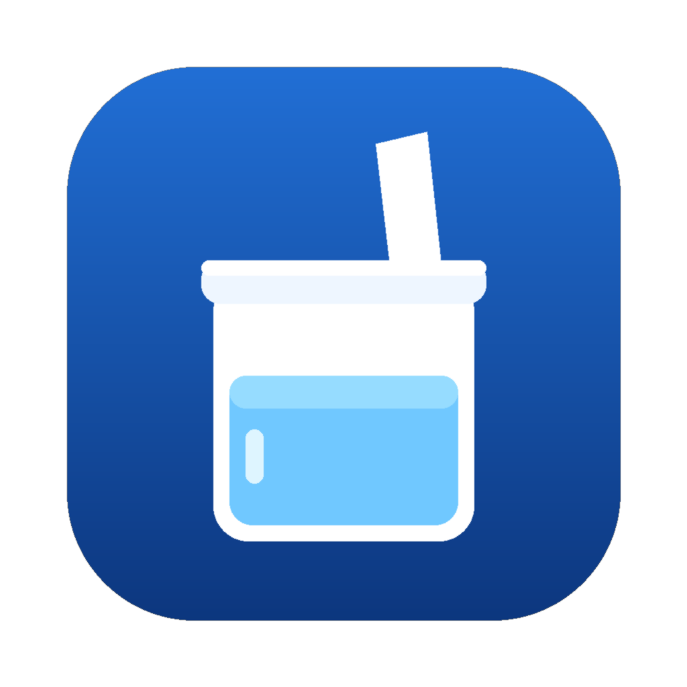

# quench

一个**不需要数据库的喝水提醒**。定时触发器每 5 分钟叫醒云函数一次，到点就往手机推一句——每天 8 次，时间随机，文案不重样。

部署在阿里云函数计算（或腾讯云 SCF）上，**电脑关机也照样推**。免费额度内，一个月几分钱都花不到。

<p></p>

---

## 它解决什么问题

大多数喝水提醒死于两件事：

1. **固定钟点会变成背景噪音**——第 3 天开始，大脑会直接跳过它。
2. **文案永远是"该喝水了"**——第一次是提醒，第二次是唠叨，第三次你把它关掉。

所以这个项目做了两个反直觉的选择：

- **时间随机**：每天 8 个点，落在 09:00–21:30 内，相邻间隔 55–137 分钟，天天不一样。
- **文案轮换**：285 条，12 种风格（打油诗、冷知识、身体拟人、谐音梗、短命令、自嘲、进度、无厘头、古诗词、文艺腔、方言、追单），一天 8 条互不重复。
- **可选追单**：主推之后 N 分钟再来一条，盯的是「你把这一杯喝完了没有」。开一个环境变量就行。

---

## 为什么不用数据库

这是这个项目最有意思的地方。

云函数每次被叫醒都是全新的进程，没有记忆。通常的做法是存个状态（Redis / 数据库 / 对象存储），记录"今天已经推了几次"。这里换了个思路：

**用「日期」当随机种子。**

```python
rng = random.Random("slots|2026-11-01")
```

同一个日期字符串，永远算出同一组时间点和同一组文案。于是：

- 函数每次醒来重新算一遍，结果和上一次完全一致——**天然幂等**；
- 不需要存任何东西，不需要同步，不需要担心状态丢失；
- 想知道"明天几点推"，本地跑 `--plan 2026-11-02` 就能看到，和云端一模一样。

状态是**计算出来的**，不是**存起来的**。整个项目因此没有一行存储代码。

---

## 快速开始

```bash
# 1. 装个 Bark（iOS），拿到你的 key
# 2. 看看排期和文案
BARK_KEY=你的key python3 water.py --plan

# 3. 试推一条
BARK_KEY=你的key python3 water.py --test

# 4. 到点就推（交给定时任务调）
BARK_KEY=你的key python3 water.py
```

没有第三方依赖，Python 3.8+ 即可。只用标准库。

### 猜猜今天几点推

```bash
$ python3 water.py --plan 2026-11-01
2026-11-01 排期：
  #1 09:19  水凉了可以再倒，嗓子哑了不好修。
  #2 11:00  碰哒鬼，水杯又空了。
  #3 12:46  3/8，杯子该续了。
  #4 14:13  吸管刚刚对着你叹气。
  #5 15:34  已经 5 杯了，别断在半路。
  #6 17:20  深情不及久伴，久伴不及一杯水放在手边。
  #7 19:03  第 7 杯。你还有 1 次。
  #8 21:02  吸管，嘴巴，动作。
```

---

## 部署到云（以阿里云函数计算为例）

完整逐屏步骤见 [`deploy/aliyun-fc.md`](deploy/aliyun-fc.md)，这里是骨架：

1. 云控制台建一个 **Python 3.9 事件函数**，入口 `index.handler`
2. 跑 `python3 build_fc.py`，把生成的 `dist/water_fc.py` 内容**整段粘进去**
3. 加一个**定时触发器**，间隔 **5 分钟**（必须等于代码里的 `TICK`）
4. 完事。

> `build_fc.py` 那一步是为了把 `water_lib.json` 内嵌进单文件——云控制台的在线编辑器只吃一个文件。

**腾讯云 SCF** 同样可用，入口名 `main_handler`。

---

## 可调参数

都在 `water.py` 顶部：

| 参数 | 默认 | 说明 |
|---|---|---|
| `WINDOW_START` / `WINDOW_END` | 09:00 / 21:30 | 推送窗口。睡前留 3 小时，免得夜里起夜 |
| `SLOTS` | 8 | 一天几次。8 × 300ml ≈ 2.4L |
| `MIN_GAP` | 55 | 相邻两次最短间隔（分钟） |
| `TICK` | 5 | 触发周期，**必须和云上的触发器间隔一致** |
| `FOLLOW_UP` | 0 | 追单：主推后多少分钟再催一次，0 = 关闭 |

**全部可以用环境变量覆盖**，改参数不用改代码：

| 环境变量 | 默认 | 说明 |
|---|---|---|
| `BARK_KEY` | 空 | **必填**，Bark 推送 key |
| `BARK_GROUP` | 喝水 | 通知分组名 |
| `BARK_SOUND` | 空 | 通知铃声 |
| `QUENCH_SLOTS` | 8 | 一天几次 |
| `QUENCH_WINDOW_START` / `QUENCH_WINDOW_END` | 9:00 / 21:30 | 推送窗口 |
| `QUENCH_MIN_GAP` | 55 | 相邻两次最短间隔 |
| `QUENCH_FOLLOW_UP` | 0 | 追单间隔（分钟），必须 ≥ `QUENCH_TICK` |
| `QUENCH_TICK` | 5 | 触发周期 |

> 例：想每天 10 次、每次追一条，就在云上配 `QUENCH_SLOTS=10` 和 `QUENCH_FOLLOW_UP=10`，代码一个字不用改。

---

## 换文案

`water_lib.json` 是「类别 → 句子列表」。加一句就是加一行，删一句就是删一行。

```json
{
  "poem": ["满杯不喝光看着，跟供着有什么区别。"],
  "progress": ["第 {n} 杯，还还剩 {left} 杯。"]
}
```

- `progress` 类里可以用 `{n}` / `{total}` / `{left}`，只在第 3/5/7 次出现；
- `nag` 类是追单文案，只在开了 `FOLLOW_UP` 时用到；
- 其他类别原样输出；
- 改动后如果部署在云上，**重新跑一次 `build_fc.py` 并重新粘贴**。

方言那一包（`dialect`）是湖南平江话，里面把称呼写成了"老乡"，你可以换成自己的诨名，方言才有味道。

---

## 已知限制

- **只管提醒，不知道你喝没喝。** 推送没有回执，所以这个项目没有打卡统计——那种数据是编出来的。
- **云函数的定时触发器有最短间隔**（阿里云 1 分钟），`TICK` 不能设得比它小。
- **跨时区**：代码里固定东八区，服务器在 UTC 也不影响；但你要在别的时区用，得改 `CST`。
- **不补发**：某个时间点如果函数没被叫醒（平台故障），那个点就没了，不会攒到下一次。

---

## License

MIT
